<div align="center">


<a href="#-pick-your-path"></a>

[](https://harshit-portfolio-3355.netlify.app)
[](https://linkedin.com/in/harshit555)
[](https://medium.com/@harshitnagila555)
[](mailto:harshitnagila3355@gmail.com)


</div>

## 👋 About me

I'm a DevOps engineer with **3 years** in cloud infrastructure. In my current role I'm the sole DevOps
engineer on **ciATHENA**, an agentic AI analytics platform for life-sciences clients. I took it from its
first environment to launch:

- **29 container apps × 3 environments** on Azure Container Apps, **85+ Terraform resources** per environment
- **10k+ requests a day** from **250+ users**
- Approval-gated releases on GitHub Actions and Azure DevOps, with revision-based **auto-rollback**
- GitHub OIDC instead of static cloud keys, Entra SSO, ISO 27001 evidence and SOC 2 preparation
- **Azure OpenAI and AWS Bedrock in production**, on regulated life-sciences data

Outside work I build open-source prototypes for problems I run into on cloud and AI platforms, write about
them on Medium, and contribute fixes upstream.

---

## 🧭 Pick your path

<details>
<summary><b>👔 Hiring? The 30-second version</b></summary>
<br/>

- **3 years** in DevOps and cloud. Sole DevOps engineer on a production agentic AI platform, from first environment to launch.
- **Azure + AWS in production**: Container Apps, ECS Fargate, Terraform, GitHub Actions / Azure DevOps, OIDC, Entra SSO.
- **AI infrastructure on regulated data**: Azure OpenAI and AWS Bedrock, ISO 27001 evidence, SOC 2 preparation.
- **Certified**: AWS CloudOps Engineer – Associate, HashiCorp Terraform Associate (004).
- **Proof beyond the day job**: two installable Kubernetes tools in Go (an Argo Rollouts canary plugin and a Vertical Pod Autoscaler memory recommender), 18 benchmarked open-source prototypes, 20+ PRs merged upstream, 10 technical articles.

📬 [harshitnagila3355@gmail.com](mailto:harshitnagila3355@gmail.com) · [LinkedIn](https://linkedin.com/in/harshit555)

</details>

<details>
<summary><b>🛠️ Engineer? Start with these three repos</b></summary>
<br/>

1. [**policy-synapse**](https://github.com/harshit3355/policy-synapse): one policy, four enforcement points, and a differential tester that catches where they disagree.
2. [**hephaestus-ledger**](https://github.com/harshit3355/hephaestus-ledger): signing the image is not enough. This proves every live AI deployment part came from the approved release.
3. [**chaos-witness**](https://github.com/harshit3355/chaos-witness): chaos tests aimed at the guarantees you promised, scored by how many of them a campaign actually checked.

Each repo has its architecture diagram, the benchmark and the limits in its README.

</details>

<details>
<summary><b>📖 Prefer reading? Start with these articles</b></summary>
<br/>

- [Your Image Is Signed. Is Your AI Deployment?](https://medium.com/@harshitnagila555/your-image-is-signed-is-your-ai-deployment-01c2dbaa572a)
- [When Terraform and the Cloud Disagree, Which One Is Right?](https://medium.com/@harshitnagila555/when-terraform-and-the-cloud-disagree-which-one-is-right-3324a1553c4d)
- [Your Chaos Test Passed. Which Guarantee Did It Actually Check?](https://medium.com/@harshitnagila555/your-chaos-test-passed-which-guarantee-did-it-actually-check-b34b55fc8353)

</details>

---

## 🧰 Tools you can install

| Project | What it does |
| --- | --- |
| [**rollouts-plugin-metric-sequential**](https://github.com/harshit3355/rollouts-plugin-metric-sequential) | Argo Rollouts metric plugin in Go. Aborts a canary when Prometheus error counts show a real regression, using a sequential test that stays valid however often Argo checks it. **Worst false rollback 1.7%, against 30.6% for a z-test checked every interval; a 2x regression is caught in about 7 intervals.** A kind end-to-end test in CI runs it inside the real Argo Rollouts controller. [v0.1.0](https://github.com/harshit3355/rollouts-plugin-metric-sequential/releases/tag/v0.1.0) ships with SHA-256 sums and SLSA build provenance. |
| [**vpa-recommender-oom-budget**](https://github.com/harshit3355/vpa-recommender-oom-budget) | Alternative Vertical Pod Autoscaler recommender in Go. You set an OOM-kill budget and it sizes each container's memory to meet it, with one margin calibrated on the whole fleet's history. On a held-out sample of Google's public Borg trace (3,179 tasks), **asked for 0.01 OOM kills per container-day, got 0.0101; asked 0.003, got 0.0030.** It does not save memory: at the same OOM rate it needs within 2 to 4% of what VPA's and KRR's defaults need. A kind end-to-end test in CI runs it with the real VPA 1.8.1 updater and admission controller. [v0.1.0](https://github.com/harshit3355/vpa-recommender-oom-budget/releases/tag/v0.1.0) ships binaries, a container image, SHA-256 sums and SLSA build provenance. |

---

## 🔬 Open-source research prototypes

18 projects. Each one takes a single failure mode, builds a working prototype, and measures it against a
baseline on a synthetic or simulated benchmark. Every README states the method, the numbers and the limits.

<p align="center">
  <a href="https://github.com/harshit3355/policy-synapse"></a>
  <a href="https://github.com/harshit3355/hephaestus-ledger"></a>
  <a href="https://github.com/harshit3355/aegis-nexus"></a>
  <a href="https://github.com/harshit3355/chaos-witness"></a>
</p>

**Security, supply chain and compliance**

| Project | What it does |
| --- | --- |
| [**policy-synapse**](https://github.com/harshit3355/policy-synapse) | Tests one policy across CI, Kubernetes admission, Terraform plan and runtime Rego. **Caught 100% of 708 injected bugs; hand-written policies caught 56.9%.** |
| [**hephaestus-ledger**](https://github.com/harshit3355/hephaestus-ledger) | Checks that every live AI deployment part (image, SBOM, Terraform state, model config, policy, identity) came from the approved release. **19/19 breaks caught; image signatures alone caught 1/19.** |
| [**aegis-nexus**](https://github.com/harshit3355/aegis-nexus) | Narrows credentials at every hop when AI agents delegate to each other across clouds. **Leakage after compromise: 242,782 → 7 weight-hours.** |
| [**janus-gate**](https://github.com/harshit3355/janus-gate) | Finds which GitHub Actions identities a cloud OIDC trust policy really accepts (AWS, Entra ID, GCP) and fails CI on the extras. |
| [**chronos-keys**](https://github.com/harshit3355/chronos-keys) | Plans secret rotation in a safe order across caches, restarts and scheduled jobs. |
| [**argus-evidence**](https://github.com/harshit3355/argus-evidence) | Builds ISO 27001 / SOC 2 control evidence continuously from cloud config and logs, in a hash-chained bundle. |
| [**ariadne-thread**](https://github.com/harshit3355/ariadne-thread) | Traces sensitive fields through OpenTelemetry Collector pipelines to the backend that stores them. |
| [**penelope-loom**](https://github.com/harshit3355/penelope-loom) | Gates AI-agent tool calls by side effect, and undoes them when a plan fails. |
| [**cassandra-upgrade**](https://github.com/harshit3355/cassandra-upgrade) | Scores dependency updates by whether your code reaches the changed functions and your tests cover them. |

**Reliability and SRE**

| Project | What it does |
| --- | --- |
| [**chaos-witness**](https://github.com/harshit3355/chaos-witness) | Chaos testing aimed at explicit guarantees, not random faults. **Found 7/7 planted weaknesses; a manual checklist found 4/7.** |
| [**faultweaver**](https://github.com/harshit3355/faultweaver) | Lets an automated fix run only when independent telemetry backs the root cause. **Unsafe actions: 29 → 11 across 240 incidents.** |
| [**burn-sentry**](https://github.com/harshit3355/burn-sentry) | SLO burn-rate alerts that stay trustworthy on low-traffic services. |
| [**orpheus-rollback**](https://github.com/harshit3355/orpheus-rollback) | Decides if a release can really be rolled back across code, schema, config and feature flags. |
| [**canary-tribunal**](https://github.com/harshit3355/canary-tribunal) | Statistically valid promote / rollback calls for LLM features scored by noisy LLM judges. |

**Platform, IaC and cost**

| Project | What it does |
| --- | --- |
| [**terracog**](https://github.com/harshit3355/terracog) | Terraform drift triage: revert, codify, quarantine or escalate. **Regret 0.59, against 2.75 for always-revert.** |
| [**titan-fleet**](https://github.com/harshit3355/titan-fleet) | One controller for LLM API routing and GPU autoscaling under SLO budgets. **Beat the baseline in 23 of 25 scenarios.** |
| [**midas-lens**](https://github.com/harshit3355/midas-lens) | Explains AI cost spikes by the deploy, prompt or config change that caused them. |
| [**carbon-oracle**](https://github.com/harshit3355/carbon-oracle) | Carbon-aware scheduling of AI jobs across regions, with a bound on missed deadlines. |

Also: [gh-oidc-trust-fixtures](https://github.com/harshit3355/gh-oidc-trust-fixtures) (labelled Terraform fixtures for OIDC trust-policy scanners) ·
[llm-gateway-quota-overshoot](https://github.com/harshit3355/llm-gateway-quota-overshoot) (reproducible harness for a LiteLLM budget-overshoot bug)

---

## 🗺️ Architecture diagrams

Every project ships its architecture as a diagram. Click one to open it, then drag to pan and scroll to zoom.

<details>
<summary><b>rollouts-plugin-metric-sequential</b>: anytime-valid canary analysis inside Argo Rollouts</summary>

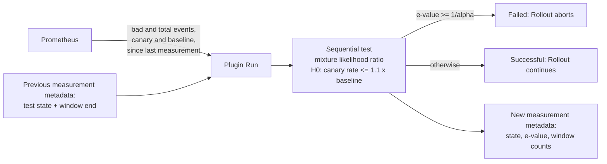

</details>

<details>
<summary><b>vpa-recommender-oom-budget</b>: VPA memory sized for an OOM-kill budget</summary>

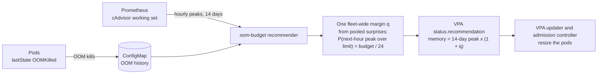

</details>

<details>
<summary><b>aws-ecs-platform-blueprint</b>: Terraform + ECS Fargate platform on AWS</summary>

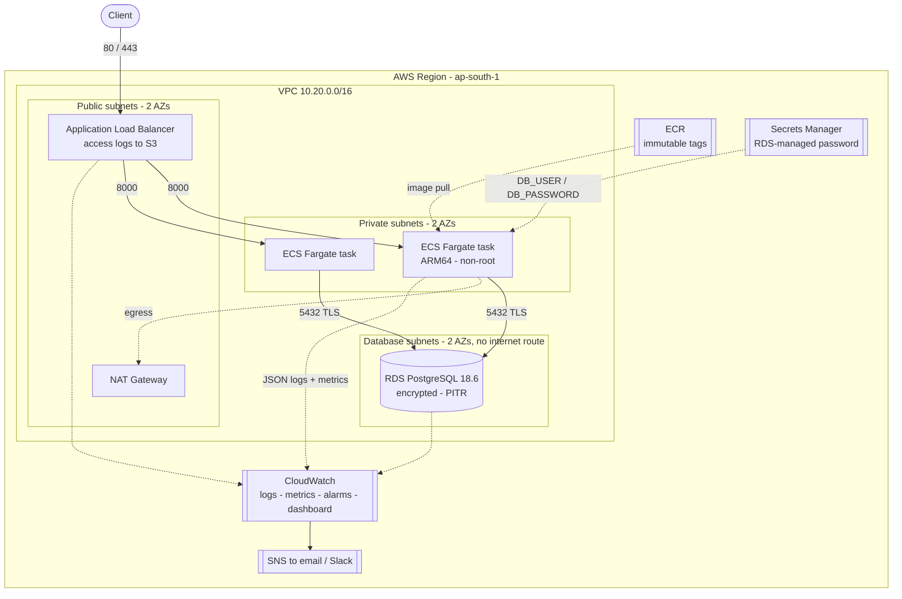

</details>

<details>
<summary><b>policy-synapse</b>: one policy intent, tested across four enforcement points</summary>

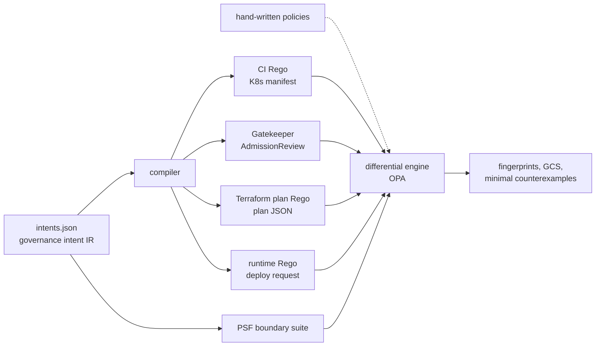

</details>

<details>
<summary><b>hephaestus-ledger</b>: release provenance for AI deployments</summary>

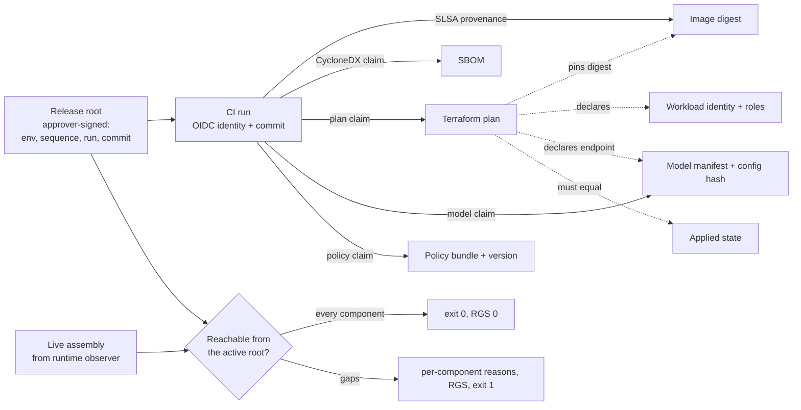

</details>

<details>
<summary><b>aegis-nexus</b>: attenuating delegation chains for AI agents</summary>

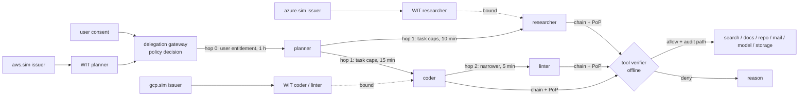

</details>

<details>
<summary><b>janus-gate</b>: who a CI-to-cloud OIDC trust policy really lets in</summary>

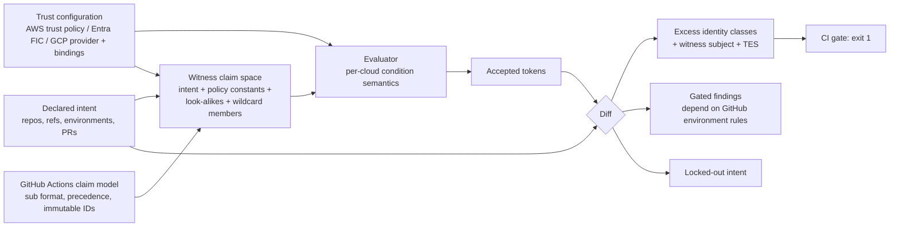

</details>

<details>
<summary><b>chronos-keys</b>: dependency-aware secret rotation</summary>

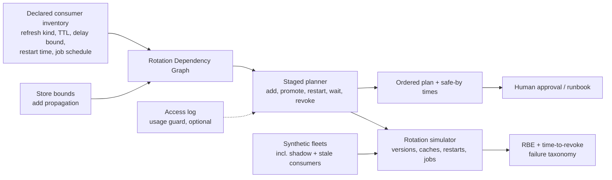

</details>

<details>
<summary><b>argus-evidence</b>: continuous ISO 27001 / SOC 2 evidence</summary>

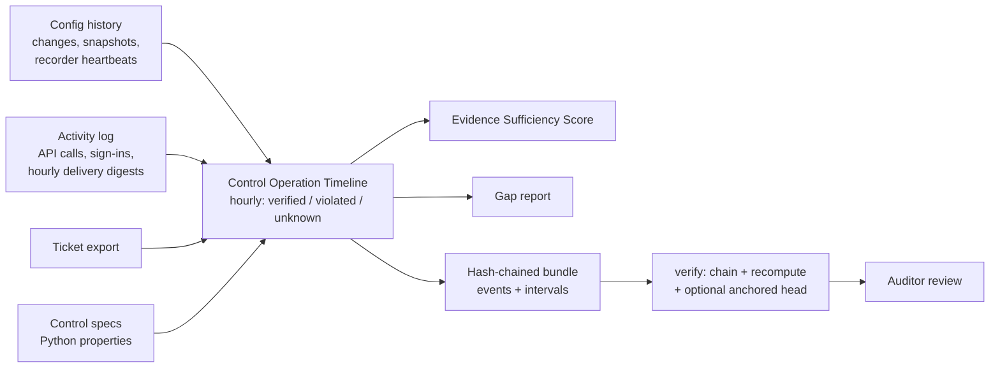

</details>

<details>
<summary><b>ariadne-thread</b>: sensitive-data lineage through telemetry pipelines</summary>

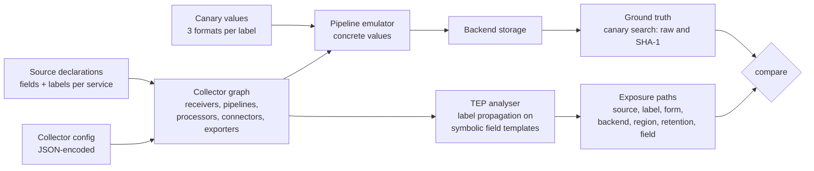

</details>

<details>
<summary><b>penelope-loom</b>: compensation-gated tool execution for AI agents</summary>

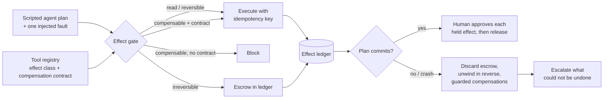

</details>

<details>
<summary><b>cassandra-upgrade</b>: break risk for dependency updates</summary>

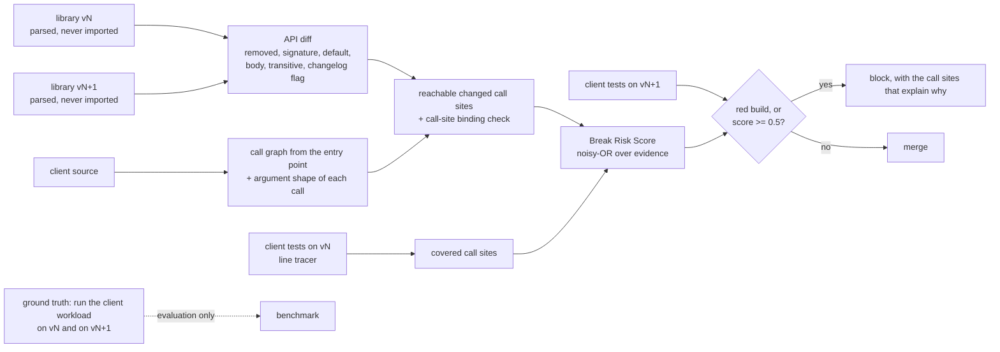

</details>

<details>
<summary><b>chaos-witness</b>: chaos campaigns aimed at explicit obligations</summary>

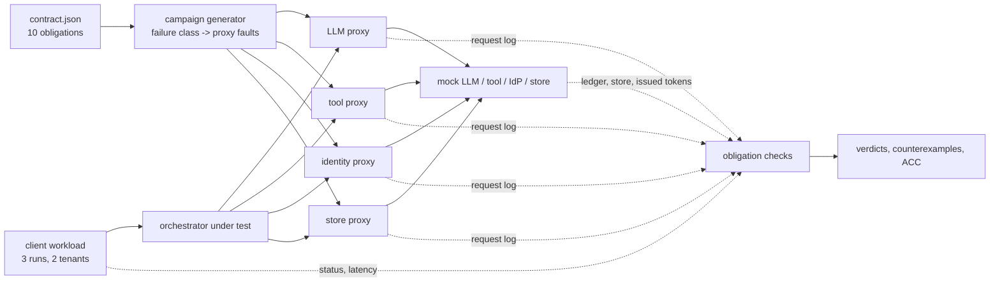

</details>

<details>
<summary><b>faultweaver</b>: evidence-bounded remediation</summary>

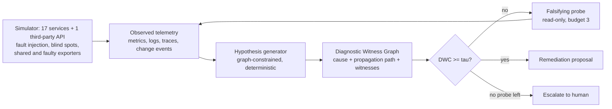

</details>

<details>
<summary><b>burn-sentry</b>: uncertainty-aware SLO burn-rate alerting</summary>

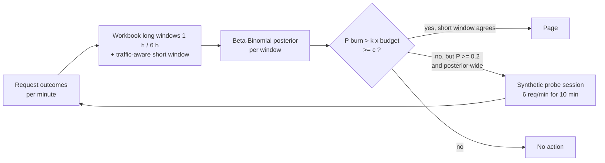

</details>

<details>
<summary><b>orpheus-rollback</b>: release reversibility analysis</summary>

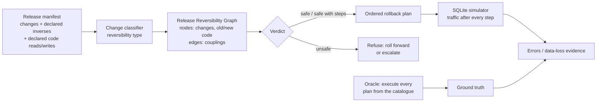

</details>

<details>
<summary><b>canary-tribunal</b>: anytime-valid canary decisions for LLM features</summary>

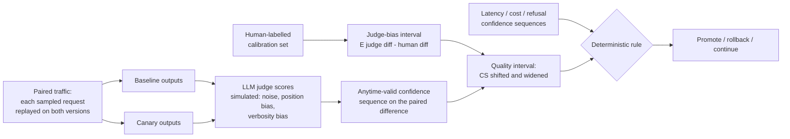

</details>

<details>
<summary><b>terracog</b>: intent-aware Terraform drift triage</summary>

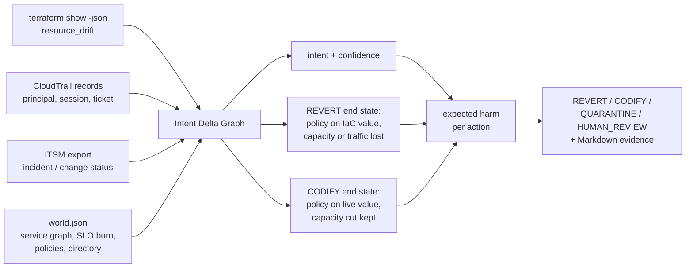

</details>

<details>
<summary><b>titan-fleet</b>: LLM API routing + GPU autoscaling under SLO budgets</summary>

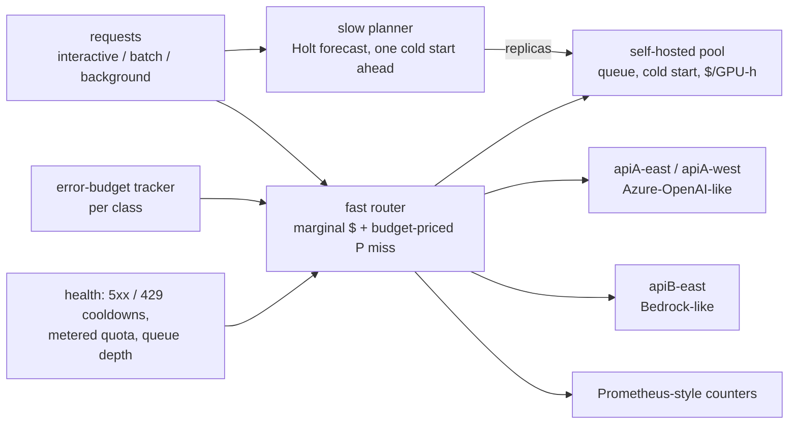

</details>

<details>
<summary><b>midas-lens</b>: change-attributed cost anomalies for AI workloads</summary>

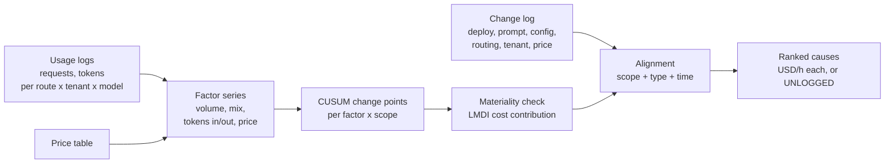

</details>

<details>
<summary><b>carbon-oracle</b>: risk-bounded carbon-aware job scheduling</summary>

```mermaid
flowchart LR
  J[synthetic AI jobs<br/>class, runtime, deadline,<br/>residency zone] --> F[feasible windows<br/>allowed regions x start slots]
  C[GB regional carbon<br/>forecast] --> O[RGW optimizer<br/>min carbon + cost]
  H[history of queue-wait and<br/>runtime errors] --> B[chance constraint<br/>P miss <= eps]
  F --> O
  B --> O
  O --> P[placement: region, submit time]
  P --> S[simulator: realised carbon,<br/>queue wait, runtime]
  S --> R[Green Regret vs<br/>hindsight oracle]
```

</details>

---

## 🤝 Upstream open-source contributions

**30+ pull requests merged** into other people's projects.
[See every merged PR →](https://github.com/search?q=author%3Aharshit3355+is%3Apr+is%3Amerged+-user%3Aharshit3355&type=pullrequests)

| Project | Contribution |
| --- | --- |
| [daniel-b92/bruno-vs-code-extension](https://github.com/daniel-b92/bruno-vs-code-extension/pull/413) | Recursive, configurable sequence normalization in the collection explorer |
| [PreethamNoelP/checkride](https://github.com/PreethamNoelP/checkride/pull/22) | Document every detected sink, checked against the source |
| [RakTikoo/ci-command-truth](https://github.com/RakTikoo/ci-command-truth/pull/6) | Test fixtures for Python tooling commands in CI |
| [dlealvilla/local-ai-stack](https://github.com/dlealvilla/local-ai-stack/pull/43) | Document the runtime override environment variables |
| [kamranzafar/flipjack](https://github.com/kamranzafar/flipjack/pull/27) | Runnable Spring Boot example app, built and tested in CI |
| [gdt050579/AppCUI-rs](https://github.com/gdt050579/AppCUI-rs/pull/296) | Window guide with real terminal screenshots and an example app |
| [GoDiao/dreamcoder](https://github.com/GoDiao/dreamcoder/pull/260) | Provider-preset tutorial in English and Chinese |
| [kathennn/stream-clip-maker](https://github.com/kathennn/stream-clip-maker/pull/6) | Side-effect-free preview mode and numbered moment selection |
| [scylladb/python-driver](https://github.com/scylladb/python-driver/pull/1273) | Set the Python 3 language level for the Cython build |
| [Consolonia/Consolonia](https://github.com/Consolonia/Consolonia/pull/735) | CI: NativeAOT smoke test |
| [Kareadita/Kavita](https://github.com/Kareadita/Kavita/pull/4972) | Fix seams between images in the webtoon reader |
| [traceopt-ai/traceml](https://github.com/traceopt-ai/traceml/pull/650) | Hide the empty step-memory card on CPU-only runs |
| [Soneso/stellar-agent-wallet](https://github.com/Soneso/stellar-agent-wallet/pull/308) | Silence intentional ShellCheck warnings on macro metavariables |
| [Stellar-Developer-Observatory](https://github.com/The-Big-Danny/Stellar-Developer-Observatory/pull/43) | CI: dependency and license audit |
| [flisk-sh/citable](https://github.com/flisk-sh/citable/pull/46) | Return 404 for static-file paths |
| [repo-engineering-skills](https://github.com/basitalisandhu/repo-engineering-skills/pull/10) | Verify environment defaults in docs ([+1 follow-up](https://github.com/basitalisandhu/repo-engineering-skills/pull/13)) |
| [hettiger/clg](https://github.com/hettiger/clg/pull/24) | Configurable release timezone |
| [adjective-rob/snap](https://github.com/adjective-rob/snap/pull/5) | Windows setup script |

---

## 🏗️ Infrastructure reference builds

| Project | What it is |
| --- | --- |
| [**aws-ecs-platform-blueprint**](https://github.com/harshit3355/aws-ecs-platform-blueprint) | Terraform + ECS Fargate on AWS: 3-tier VPC, RDS PostgreSQL, gated GitHub Actions delivery, Prometheus/Grafana and CloudWatch |
| [**aws-ecs-terraform**](https://github.com/harshit3355/aws-ecs-terraform) | `Internet → ALB → ECS Fargate → RDS`, plus local Postgres with migrations, seed data and self-verifying backup/restore |
| [**ansible-linux-lab**](https://github.com/harshit3355/ansible-linux-lab) | Ansible done properly: inventory as code, idempotent roles, validated handlers, staged rollouts, health checks |
| [**wisecow-kubernetes-tls**](https://github.com/harshit3355/wisecow-kubernetes-tls) | A legacy Bash service containerised and run on Kubernetes behind NGINX Ingress with cert-manager TLS |
| [**flask-counter-ecr-pipeline**](https://github.com/harshit3355/flask-counter-ecr-pipeline) | Source to resource-capped container: Docker, SonarQube, GitHub Actions to Amazon ECR |
| [**strapi-ephemeral-ec2-environments**](https://github.com/harshit3355/strapi-ephemeral-ec2-environments) | Disposable environments on EC2: Terraform plus on-demand deploy and destroy workflows |
| [**azure-vm-health-check**](https://github.com/harshit3355/azure-vm-health-check) | Bash sweep of VMs across Azure subscriptions, CPU/memory/disk as CSV with threshold alerts |
| [**selfhosting-reference-library**](https://github.com/harshit3355/selfhosting-reference-library) | Compose stacks, Ansible playbooks and reverse-proxy configs for ~90 self-hosted services |

---

## ✍️ Writing

I write up each project on [Medium](https://medium.com/@harshitnagila555): the problem, what I built, the numbers and the limits.

- [Your Chaos Test Passed. Which Guarantee Did It Actually Check?](https://medium.com/@harshitnagila555/your-chaos-test-passed-which-guarantee-did-it-actually-check-b34b55fc8353)
- [The Linter Should Not Hold the Keys to the Kingdom](https://medium.com/@harshitnagila555/the-linter-should-not-hold-the-keys-to-the-kingdom-6a7d0e97580d)
- [Right Service, Wrong Fix](https://medium.com/@harshitnagila555/right-service-wrong-fix-adc57294a60e)
- [When Terraform and the Cloud Disagree, Which One Is Right?](https://medium.com/@harshitnagila555/when-terraform-and-the-cloud-disagree-which-one-is-right-3324a1553c4d)
- [Your LLM Gateway and Your GPU Autoscaler Don't Share a Budget](https://medium.com/@harshitnagila555/your-llm-gateway-and-your-gpu-autoscaler-dont-share-a-budget-31f0278bc1aa)
- [Your Image Is Signed. Is Your AI Deployment?](https://medium.com/@harshitnagila555/your-image-is-signed-is-your-ai-deployment-01c2dbaa572a)
- [One Rule, Four Policies: Testing Policy-as-Code Across Enforcement Surfaces](https://medium.com/@harshitnagila555/one-rule-four-policies-testing-policy-as-code-across-enforcement-surfaces-38fa87a24ced)
- [AI Agents Are Writing Your Infrastructure Code. Is Anyone Governing It?](https://medium.com/@harshitnagila555/ai-agents-are-writing-your-infrastructure-code-is-anyone-governing-it-2a2db17750f7)
- [Forty Minutes Was Enough](https://medium.com/@harshitnagila555/forty-minutes-was-enough-19709bc59072)
- [Deploy Without Fear](https://medium.com/@harshitnagila555/deploy-without-fear-5992ac7dbca6)

---

## 🧰 Tech

<p>
  
</p>

**Cloud**: Azure (Container Apps, App Service, Front Door, APIM, Key Vault, Logic Apps, Azure OpenAI, Cosmos DB) · AWS (ECS Fargate, EKS, ECR, Lambda, EventBridge, S3, RDS, CloudFront, Bedrock) · GCP

**Infrastructure as code and containers**: Terraform (modular, multi-environment) · Ansible · Docker · Kubernetes · Helm · NGINX Ingress · cert-manager

**CI/CD and GitOps**: GitHub Actions · Azure DevOps · GitLab CI · Jenkins · Argo CD · GitHub OIDC

**DevSecOps**: Trivy · SonarQube · Gitleaks · Bandit · Safety · Snyk · OPA / Rego · Checkov

**Observability**: Prometheus · Grafana · Log Analytics · CloudWatch · CloudTrail · Datadog · ELK

**Languages**: Python · Bash · SQL · JavaScript

---

## 🎖️ Certifications


---

## 📊 GitHub activity

<div align="center">
  
  <br/><br/>
  
  
  <br/><br/>
  
  <br/><br/>
  <picture>
    <source media="(prefers-color-scheme: dark)" srcset="https://raw.githubusercontent.com/harshit3355/harshit3355/output/github-snake-dark.svg" />
    <source media="(prefers-color-scheme: light)" srcset="https://raw.githubusercontent.com/harshit3355/harshit3355/output/github-snake.svg" />
    
  </picture>
</div>

---

<div align="center">

<sub>MCA, Manipal University Jaipur (CGPA 9.01) · BCA, Chandigarh University · Employee of the Quarter, Q1 2025<br/>
Former GDSC Cloud Lead: taught cloud to 500+ students through hands-on workshops</sub>


<sub>Widgets: [GitSkins](https://www.gitskins.com) (Midnight) · [capsule-render](https://github.com/kyechan99/capsule-render) · [readme-typing-svg](https://github.com/DenverCoder1/readme-typing-svg) · [github-readme-stats](https://github.com/stats-organization/github-readme-stats-action) · [streak-stats](https://github.com/DenverCoder1/github-readme-streak-stats) · [Platane/snk](https://github.com/Platane/snk)</sub>

</div>
